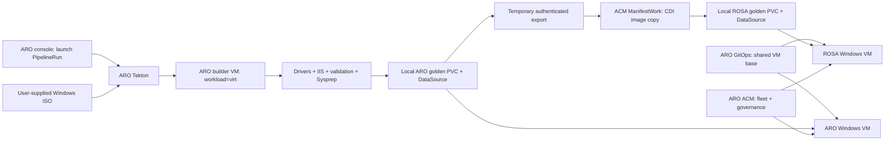

# From VM Islands to One Operating Model

A 15-minute console demo: **Team X's Windows VM factory**, with ARO as the build/management hub and ROSA HCP as a hypothetical DR destination.

All Windows image building runs on ARO using its installed Pipelines and Virtualization operators. ARO GitOps manages both destinations; ACM provides the shared inventory and governance view. Golden disks remain on cluster PVCs: ANF on ARO, FSx/Trident on ROSA. No external image bucket is required.



## Live setup

- ARO: `acm-hub-aro`, OpenShift 4.21.22, Virtualization 4.21.17; VM placement explicitly selects `workload=virt`.
- ROSA HCP: `rosa-virt-dr`; VM placement selects the `m5zn.metal` worker.
- Storage: ARO `anf`, ROSA `trident-csi`, both Filesystem/RWX.
- ARO namespace `image-factory`: Windows factory pipeline, readiness pipeline, reviewed Red Hat ISO task, controller code and built toolbox image.
- GitOps destinations use dedicated `team-x` service accounts and TLS verification. Credentials remain valid until revoked, rather than expiring after a day.
- Unique Windows Administrator passwords exist only in the per-cluster runtime Secrets, outside Git.

**The Windows image pipeline is running with the user-supplied ISO and explicit license acceptance.** Its completion and first-boot validation will be recorded in the live setup record. The Windows applications remain manual-sync until their golden sources exist. Two additional Fedora VMs are already deployed from the clusters’ existing bootable volumes, and their applications are Synced/Healthy with HTTPS readiness verified.

## Console login and reusable projects

The existing Fedora VMs use `fedora`; reveal the password from Secret `team-x/linux-vm-login`, key `fedora`, on the corresponding cluster. Windows uses `Administrator`; its password is in `team-x/team-x-win-v100-answer`, key `password`. Passwords are unique per cluster and are not committed.

[Standalone examples](examples/README.md) use `linux-vms-prod` and `windows-vms-vdi`, with complete rendered YAML bundles for console import. The existing workloads stay in `team-x`.

## Presenting

1. Inspect the ready `team-x-linux-aro` and `team-x-linux-rosa` GitOps applications and their VMs in ACM.
2. Follow [the ARO console workflow](docs/console-workflow.md) to build a golden image before the talk.
3. Sync the two Windows applications in ARO GitOps after the pipeline finishes and both local DataSources are ready.
4. Rehearse using [the 15-minute runbook](docs/demo-runbook.md).

[Deployment and lifecycle details](docs/deployment.md) explain credentials, replacement image releases and cleanup. No prepared demo credential or golden PVC has a 24-hour expiry. Temporary export credentials are created during a build and removed after the copy; they are not required to run the resulting VMs. Keep the underlying clusters/storage available for the presentation.

## Files

| Directory | Purpose |
|---|---|
| `windows/` | Unattended Windows install, team customization, tests and generalization |
| `pipelines/` | Tekton pipelines/tasks, local publication, ACM image copy, restricted ISO SCC |
| `vm/` | Shared Windows and existing-volume Fedora VM definitions, cloud-specific storage and placement |
| `gitops/` | Applications, namespace-scoped runtime RBAC and source clone permission |
| `governance/` | ACM placement and inform-only team/image-version policy |
| `console/` | Ready-to-configure PipelineRun YAML sample in the ARO console |
| `tools/` | ARO BuildConfig and Containerfile for the task image |
| `scripts/` | Validation, registration and runtime credential helpers |

## Verification

```bash
bash scripts/validate.sh
```

Offline checks cover YAML/Kustomize, selectors, disk wiring, placement and failure gates. Cluster integration checks are recorded in [the live setup record](docs/live-setup.md). Windows installation, Sysprep, first boot and end-to-end image transfer require the user-supplied ISO and a rehearsal; do not present them as completed until they pass.

## References

- [Red Hat Windows golden images](https://developers.redhat.com/articles/2024/09/09/create-windows-golden-image-openshift-virtualization)
- [Red Hat ISO task 4.21.0](https://artifacthub.io/packages/tekton-task/redhat-tekton-tasks/modify-windows-iso-file/4.21.0), vendored for review and reproducibility
- [KubeVirt sysprep media](https://kubevirt.io/user-guide/user_workloads/startup_scripts/)
- [KubeVirt export API](https://kubevirt.io/user-guide/storage/export_api/)
- [CDI cross-namespace clones](https://github.com/kubevirt/containerized-data-importer/blob/main/doc/clone-datavolume.md)

This is a custom demo workflow. The ROSA role demonstrates image staging and consistent provisioning, not automatic disaster recovery, application-data replication or a supported cross-cloud live-migration claim. The Windows customization installs IIS and drivers; it does not establish patch or vulnerability compliance.
